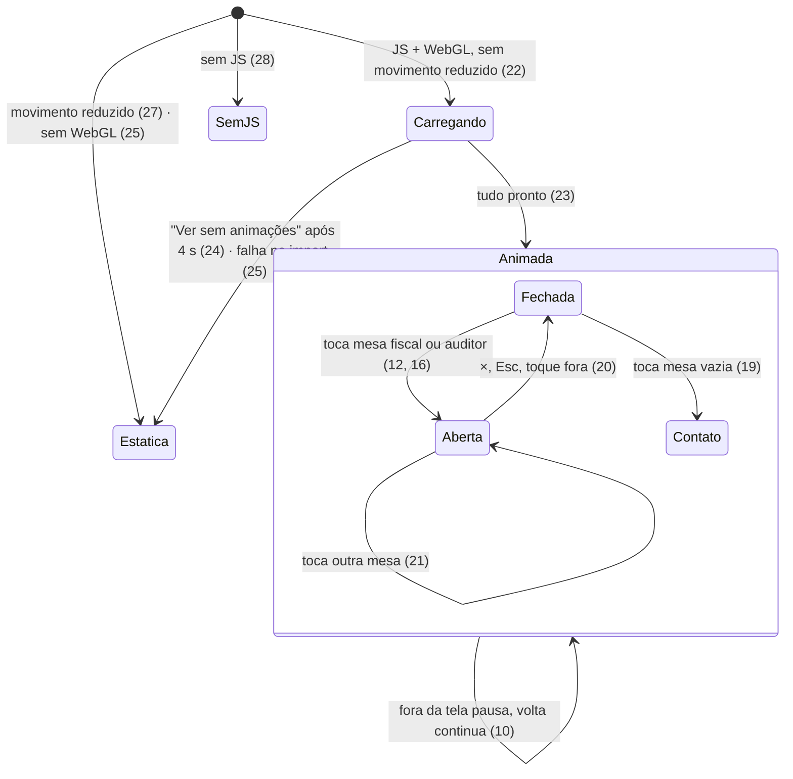

# /agentes/ como "Escritório nó" interativo

> Build this with **tlc-implement**.
> Every criterion below becomes a check with a proof, referenced by its number. Nothing under
> `Unresolved` gets settled while building.
> Execução em paralelo no Personal Workspace: cada frente constrói só os critérios e os arquivos
> que `.tasks/agentes-escritorio-frentes.md` lhe dá.

## Intent

Hoje a `/agentes/` é uma página de dois cartões com o CSS emprestado do auditor (`/agentes/auditor/auditor.css`) e destoa da home, de `/contato/`, `/sobre/` e `/agencia/`. Ela é o destino do "link na bio" do Instagram na campanha de novembro da Nó Agentes. O primeiro post, um carrossel de apresentação, sai na quarta 28/10 ou na quinta 29/10, e quem tocar no link cai numa página que não mostra o que os agentes fazem. A fonte não traz número de visitas nem de conversão desta página.

Com a mudança, quem abre `/agentes/` no celular vê um escritório 3D isométrico da Nó com os agentes trabalhando sem parar. Ao tocar numa mesa, sobe uma gaveta com a conversa de WhatsApp daquele agente, encenada como demonstração, e um botão para a LP dele. No fim da página, as mesas se ligam a uma sala "nó tech stack": "quando forem vários, a gente une tudo num sistema só". Antes das animações aparece uma tela de carregamento, e quem esperar demais pode ver a versão sem animações. Referência de interface: `.tasks/refs/agentes-escritorio-referencia.webp`.

32 critérios em 5 fatias · 0 portas de mão única · 7 em aberto, 0 bloqueiam

## Criteria

### Página que funciona sem a cena (conteúdo, SEO, navbar e rodapé)

1. Quando `/agentes/` é servida, o HTML, mesmo sem JS, já contém, nesta ordem:
   - o rótulo `NÓ AGENTES`;
   - o `h1` "Cada agente resolve um problema da sua empresa.";
   - o subtítulo "Por assinatura. Toque numa mesa para ver o agente trabalhando.";
   - um botão por mesa: `nó.fiscal`, `Auditor` e "um problema seu aqui?";
   - o `h2` do fecho "Quando forem vários, a gente une tudo num sistema só.";
   - os dois cartões de produto;
   - o botão "Conte sua ideia", que leva a `/contato/`.
2. O cartão `nó.fiscal` diz "Emite a NFS-e pelo WhatsApp, para MEI e Simples." e leva a `/agentes/fiscal/`. O cartão `Auditor` diz "Confere se o rastreamento dos seus anúncios conta certo." e leva a `/agentes/auditor/`. O texto do auditor que aparece na imagem de referência ("Revisa e organiza seus documentos") está errado e não entra.
3. Sempre continuam iguais ao `main` em `9e83de87`:
   - `title`, `meta description`, `canonical` (`https://www.notechstack.com.br/agentes/`) e as tags `og:`/`twitter:`;
   - `shared/telemetria.js?v=3`, carregado antes do snippet do GTM;
   - o snippet do GTM `GTM-NK87FH8W`, condicionado por `noMarketingHostAllowed`, e o `<noscript>` dele;
   - a entrada `/agentes/` em `sitemap.xml`.
4. Sempre: rodar `node shared/sync-site-layout.mjs` na branch não altera `agentes/index.html`, ou seja, os trechos `site-nav` e `site-footer` são os canônicos.
5. Sempre: a página não carrega mais `/agentes/auditor/auditor.css`. Os estilos dela vêm de `/brand/tokens/tokens.css`, `/shared/site.css`, `/shared/site-layout.css`, `/shared/card-nav.css` e dos arquivos próprios em `agentes/`, sem cor hex solta fora dos tokens.

### Escritório 3D em movimento constante

6. Quando a cena está montada numa tela de 375×812, o canvas mostra, de cima para baixo:
   - a mesa do `nó.fiscal`, com etiqueta de ponto verde;
   - a mesa do `Auditor`, com etiqueta de ponto azul;
   - a mesa vazia, com etiqueta "um problema seu aqui?" de ponto âmbar;
   - a recepção, com o balcão e o "nó." na frente dele.

   É o enquadramento da Tela 1 da referência.
7. Sempre:
   - a cena não tem mascote nem animal: só os dois personagens, móveis, plantas e objetos de escritório;
   - os personagens são figuras de corpo em cápsula e cabeça redonda, com crachá na cor do agente: verde no fiscal e azul no auditor;
   - nenhum personagem tem nome de pessoa;
   - a cena não usa nada da planta nem dos nomes de *The Office*.
8. Sempre: o "nó." do balcão é uma textura plana feita de `/brand/logo/svg/no-tinta-ponto-azul.svg`, sem extrusão, sombra própria nem contorno.
9. Enquanto a cena está visível e a aba ativa, os dois personagens se mexem sem parar:
   - em dois quadros capturados com 1 s de intervalo, a região de cada um dos dois difere;
   - após 60 s, o mesmo teste ainda dá diferença;
   - o laço não tem ponto de parada.
10. Enquanto o canvas está fora da tela ou a aba está oculta, nenhum quadro é renderizado: o contador de quadros exposto pela cena não sobe. Ao voltar à tela, a animação continua.
11. Quando a pessoa rola até o fecho, a cena se afasta e mostra as três mesas ligadas por linhas azuis `#3D63DB` a uma sala envidraçada com placa "nó tech stack". É o enquadramento da Tela 3 da referência. Ao rolar de volta, o enquadramento volta ao da Tela 1.

### Mesas que abrem a conversa no WhatsApp

12. Quando a pessoa toca a mesa do `nó.fiscal`, seja no canvas ou no botão HTML equivalente:
    - a câmera aproxima essa mesa, como na Tela 2;
    - sobe uma gaveta com o selo `DEMONSTRAÇÃO`;
    - a gaveta tem o título "nó.fiscal — sua NFS-e pelo WhatsApp";
    - dentro dela há um mockup de WhatsApp, descrito no critério 13.
13. O mockup de WhatsApp tem:
    - cabeçalho com avatar e nome `nó.fiscal`;
    - fundo de conversa;
    - balões da pessoa à direita, verdes, com hora e ✓✓;
    - balões do agente à esquerda, brancos.

    As mensagens entram uma a uma, cada uma depois de um indicador "digitando…", nesta ordem e com estes textos (copiados de `agentes/fiscal/fiscal.js`):
    1. pessoa: "nota pra Studio Lima, 350 reais";
    2. agente: resumo com `Tomador` Studio Lima, `Valor` R$ 350,00, `Serviço` "Modelo padrão · 04.01.01", depois "Confirmo a emissão?" e os botões "Confirmar emissão" e "Corrigir";
    3. pessoa: "Confirmar emissão";
    4. agente: "Emitindo…" com os passos "Montando a DPS 1.01", "Assinando com o certificado A1", "Transmitindo à Sefin Nacional" e "NFS-e autorizada", marcados um a um;
    5. agente: "Pronto! NFS-e autorizada.", com os anexos `danfse-<nº>.pdf` e `nfse-<nº>.xml` e o carimbo "simulação".
14. Enquanto a gaveta do fiscal está aberta, a conversa recomeça da mensagem 1, 4 s depois de chegar à mensagem 5.
15. A gaveta do fiscal tem o botão "Simular uma emissão", que leva a `/agentes/fiscal/#simulador`.
16. Quando a pessoa toca a mesa do `Auditor`, a câmera aproxima essa mesa e sobe uma gaveta com o selo `DEMONSTRAÇÃO` e o título "Auditor — seu relatório semanal no WhatsApp". Dentro há o mesmo mockup de WhatsApp, com:
    - cabeçalho com o nome `nó.` e o subtítulo "equipe nó";
    - uma única mensagem recebida, entrando depois do indicador "digitando…".

    A mensagem segue o formato de `textoCopia` em `supabase/functions/marketing-hub/auditor.ts`:
    - a linha em negrito `Relatório semanal · <negócio> (<dd/mm> a <dd/mm>)`;
    - o resumo;
    - `Prioridades`, numeradas no formato `<n>. <título>: <o que fazer>`;
    - a linha `Relatório completo:` com um link.
17. Abaixo do mockup do Auditor fica a nota "Cópia opcional do relatório, enviada pela equipe da nó. O relatório chega no e-mail e no painel." A cópia por WhatsApp hoje é manual e opcional (`app/src/auditor/CopiaWhatsapp.tsx`), e a página não pode dar a entender que um robô a envia.
18. A gaveta do Auditor tem o botão "Diagnosticar grátis", que leva a `/agentes/auditor/`.
19. Quando a pessoa toca a mesa vazia, o navegador vai para `/contato/`, sem abrir gaveta.
20. Quando a gaveta está aberta, ela fecha:
    - pelo botão ×;
    - pela tecla `Esc`;
    - pelo toque fora dela.

    Ao fechar, a câmera volta ao enquadramento anterior e o foco volta ao botão da mesa que abriu a gaveta. Com a gaveta aberta, o foco do teclado fica dentro dela.
21. Se a pessoa toca outra mesa com uma gaveta aberta, ou toca a mesma mesa duas vezes em menos de 300 ms, fica aberta uma única gaveta, a da última mesa tocada. Os temporizadores da conversa anterior são cancelados: nenhuma mensagem da conversa anterior aparece depois.

### Tela de carregamento e versão sem animações

22. Quando a página abre com JS e WebGL, sem `prefers-reduced-motion: reduce`, uma tela de carregamento cobre a viewport. Ela mostra:
    - o "nó." do SVG oficial;
    - os quatro pontos da assinatura animando, na ordem azul → vermelho → âmbar → verde;
    - o texto "Montando o escritório…";
    - um progresso de 0 a 100%.
23. A tela de carregamento some quando tudo isto está pronto: as fontes Sora e JetBrains Mono, o three.js, a cena montada, o primeiro quadro desenhado e os scripts da gaveta. A página aparece com o escritório já em movimento.
24. Se a carga não termina em 4 s, aparece na tela de carregamento o botão "Ver sem animações". Ao tocar nele, a versão estática entra na hora e a cena já não aparece, mesmo que termine de carregar depois.
25. Se o import do three.js ou da cena falha, ou se o navegador não tem WebGL, a versão estática entra sozinha, sem tela de carregamento nem botão.
26. Na versão estática:
    - no lugar do canvas aparece a imagem pré-renderizada do escritório, `agentes/escritorio/poster-escritorio.webp`, e, no fecho, `agentes/escritorio/poster-fecho.webp`;
    - as mesas continuam tocáveis pelos botões HTML;
    - a gaveta mostra a conversa inteira de uma vez, sem animação e sem "digitando…".
27. Com `prefers-reduced-motion: reduce`, a página abre direto na versão estática, sem tela de carregamento.
28. Sem JS, a tela de carregamento não aparece e o conteúdo do critério 1 fica visível e legível.
29. Sempre que a versão estática entra, o console registra `[agentes] versão estática: <motivo>`, com `<motivo>` igual a `pediu`, `falha`, `sem-webgl` ou `movimento-reduzido`.

### Celular primeiro, desktop sem quebra

30. Em 375×812 e 390×844:
    - `document.documentElement.scrollWidth` é igual a `clientWidth`, ou seja, não há rolagem horizontal;
    - a navbar e o rodapé aparecem como em `/contato/`;
    - cada mesa, botão e o × da gaveta têm alvo de toque de pelo menos 44×44 px.
31. Em 375×812, a gaveta ocupa no máximo 75% da altura da tela, e a mesa aproximada continua visível acima dela, como na Tela 2.
32. Em 1440×900 não há rolagem horizontal, a navbar e o rodapé aparecem como em `/contato/` e a cena tem no máximo 720 px de largura, centralizada.

## Rodada 3 · renegociado por Lucca em 26/10/2026

Lucca testou a versão `cd1f41fe` e pediu as mudanças abaixo, comparando com a referência. Onde um item
abaixo conflita com um critério acima, vale o item abaixo.

- **R1 · nome** (resolve o Unresolved 6): `nó.auditor` substitui `Auditor` no botão e na etiqueta da mesa (critérios 1 e 6), no cartão (2) e no título da gaveta, que passa a ser "nó.auditor — seu relatório semanal no WhatsApp" (16).
- **R2 · cena integrada à tela** (critérios 6 e 32): a cena vai de borda a borda no celular, sem caixa, borda nem fundo de outra cor. O topo dela se funde ao fundo da página num degradê de pelo menos 64 px logo abaixo do subtítulo, e a base se funde do mesmo jeito antes do conteúdo seguinte. Na Tela 2, a cena ocupa o topo, logo abaixo da navbar, e a gaveta sobe por cima com cantos arredondados, como na referência.
- **R3 · luz e cor:** a cena fica mais quente e menos clara, com sombras projetadas visíveis sob mesas, cadeiras, pessoas e plantas, e sombra de contato no chão. Na Tela 1, em 375×812, a mediana RGB da área da cena fica a no máximo ±12 por canal de `[220, 199, 170]` (medida da Tela 1 da referência), e a luminância média, em no máximo 190 (a referência dá 183; a `cd1f41fe` dava 202).
- **R4 · etiqueta em destaque:** a etiqueta de cada mesa tem um círculo cheio na cor do agente, com pelo menos 16 px em 375 de largura, e um halo dessa cor pulsando em volta, em laço. Verde no fiscal, azul no nó.auditor, âmbar na vaga.
- **R5 · crachás:** o crachá é um cartão retangular com faixa na cor do agente e o "nó." da marca, preso a um cordão da mesma cor, e fica legível na Tela 2.
- **R6 · gaveta:** antes do mockup, a gaveta mostra uma explicação breve do agente, com no máximo 2 frases e 180 caracteres, tirada da LP dele, sem afirmação nova. O mockup fica compacto: continua reconhecível como WhatsApp (cabeçalho verde, fundo com rabiscos, balões e ✓✓), mas sem ocupar a tela. Em 375×812, a gaveta inteira ocupa **no máximo 62%** da altura (substitui os 75% do critério 31), e a conversa rola dentro de uma janela de no máximo 300 px.
- **R7 · rolagem** (substitui o critério 11): rolar até o fecho **não** afasta a câmera para mostrar o escritório inteiro. A câmera viaja até a sala envidraçada "nó tech stack" e a enquadra em destaque: a sala ocupa pelo menos 45% da largura do canvas, e a altura do quadro varia no máximo 15% entre a Tela 1 e o fecho. As três linhas azuis `#3D63DB` acendem das mesas até a sala durante a viagem. Ao rolar de volta, a câmera volta à Tela 1.
- Continua valendo: nada de polvo, mascote ou animal.

## Rodada 4 · ajustes de Lucca sobre as prévias do Blender (26/10/2026)

Vale sobre a rodada 3 onde houver conflito.

- **R8 · contraste:** a cena fica mais escura e os elementos se separam uns dos outros: mesas, balcão, escada, piso, paredes e o corpo das pessoas ganham tons e valores distintos, e não "tudo meio da mesma cor". Na Tela 1, a luminância média fica em no máximo 165 (a prévia `74023d6d` dava 178) e o desvio-padrão da luminância, em pelo menos 62 (a prévia dava 55; a referência, 56).
- **R9 · etiquetas com contorno:** a etiqueta do `nó.fiscal` tem contorno verde (`--no-verde`), a do `nó.auditor`, contorno azul (`--no-azul`), ambos com pelo menos 2 px em 375 de largura, e o círculo cheio da R4 continua.
- **R10 · terceira mesa:** a etiqueta e o botão "um problema seu aqui?" passam a dizer **"criar uma automação"** (substitui esse texto nos critérios 1 e 6), com contorno âmbar (`--no-ambar`) piscando em laço. O toque continua levando a `/contato/` (critério 19).
- **R11 · rolagem** (substitui a R7): a câmera mantém o mesmo zoom e o mesmo ângulo da Tela 1 e só desliza para a direita, como se fosse arrastada, até enquadrar a sala "nó tech stack". A altura do quadro varia no máximo 3% entre a Tela 1 e o fecho; a câmera não se afasta.
- **R12 · cabos:** as três linhas `#3D63DB` passam sempre **acima** do piso, sem atravessá-lo. Correm organizadas, lado a lado, em curvas suaves, sem se cruzar, cada uma da sua mesa até a sala. São cabos com volume e acabamento (tubo arredondado com pulsos de luz correndo até a sala), e não traços simples.

## Rodada 5 · cena vinda do Blender (26/10/2026)

Lucca aprovou levar ao site a cena de `.tasks/blender/escritorio.blend` (commit `e804351b`).

- **R13 · critério 7:** deixa de exigir `CapsuleGeometry` e `SphereGeometry`. Passa a exigir: duas pessoas, os nós `pessoa-fiscal` e `pessoa-auditor`, cada uma com o crachá `cracha-<agente>` cuja faixa tem a cor do token do agente (`--no-verde` e `--no-azul`); nenhum nó com nome de pessoa; nada de *The Office*; nenhum mascote ou animal.
- **R14 · critério 8 continua igual:** o "nó." do balcão é criado pelo three.js como `PlaneGeometry` com a textura de `/brand/logo/svg/no-tinta-ponto-azul.svg`, posicionado no marcador `marca-logo-balcao` do GLB.
- **R15 · pôsteres** (critério 26): passam a ter 750×1040 (375:520 @2x, a proporção do canvas da página), nos quadros `tela1` e `fecho`, renderizados da cena do site.
- **R16 · peso:** um único `agentes/escritorio/escritorio.glb` de no máximo 3 MB, com meshopt e texturas WebP.

## States

## Out of scope

- Digitar na conversa ou emitir/diagnosticar de dentro da gaveta: o simulador e o diagnóstico de verdade ficam nas LPs. Duplicar isso aqui cria duas versões para manter.
- Personagens andando entre as mesas, a sala "nó tech stack" interativa e porta abrindo: ficam para uma fase 2, depois do post.
- Qualquer mudança em `agentes/fiscal/`, `agentes/auditor/` e nos demais arquivos dessas LPs.
- Nova imagem `og:`, novo `title` ou nova `description`. O critério 3 mantém os atuais.
- Importar ou publicar configuração no GTM.
- Push, PR, merge e deploy sem a confirmação expressa de Lucca.

## Observable

| Surface | Decision | Landing |
| --- | --- | --- |
| tela `/agentes/` | estado vazio | n/a - conteúdo fixo, não depende de dado da pessoa |
| tela `/agentes/` | carregando | 22, 23, 24 |
| tela `/agentes/` | erro | 25, 29 |
| tela `/agentes/` | sem autorização | n/a - página pública |
| tela `/agentes/` | densidade e ordem | 1, 6, 30, 31, 32 |
| tela `/agentes/` | ação destrutiva confirma | n/a - não há ação destrutiva |
| gaveta da mesa | estado vazio | n/a - a conversa é roteiro fixo |
| gaveta da mesa | carregando | 13 ("digitando…"), 26 (estática mostra tudo) |
| gaveta da mesa | erro | n/a - nada é buscado na rede ao abrir |
| gaveta da mesa | ordem | 13, 16 |
| gaveta da mesa | fechar | 20 |
| texto para o leitor | estrutura e próximo passo | 1, 2, 15, 18, 19 |
| texto para o leitor | tom | Unresolved 3 (texto do relatório semanal) |

## Swept

- validation: n/a - a página não recebe entrada da pessoa; a gaveta é roteiro, sem campo.
- failure modes: 24, 25.
- idempotency and retry: 14 (o laço recomeça igual), 21 (toque duplo não abre duas gavetas).
- authorization: n/a - página pública, sem conta.
- concurrency and ordering: 21 (troca de mesa cancela os temporizadores da conversa anterior).
- data lifecycle: n/a - nada é gravado no navegador nem no servidor; a escolha "Ver sem animações" vale só para aquela visita (Unresolved 5).
- external-dependency failure: 25 (o three.js vem do jsDelivr pelo importmap, como na home).
- state transitions: 22–27, diagrama em States.
- observability: 29; medição de toques e CTAs é Unresolved 4.

## Impact

| Front | What changes |
|---|---|
| domain | termo novo: `versão estática` - a página sem canvas, com pôster e conversa inteira; vive em `agentes/` |
| domain | termo novo: `gaveta` - o painel que sobe da mesa com a conversa; vive em `agentes/escritorio/` |
| páginas | `/agentes/` deixa de depender de `agentes/auditor/auditor.css`. O arquivo continua igual e segue servindo a LP do auditor. |
| medição | `telemetria.js` e GTM continuam iguais. A telemetria só rastreia cliques em links `wa.me`, e a página nova não cria nenhum: o mockup de WhatsApp não é link. |
| stored data | nada a migrar |

## Decided

| Decision | Shape | Alternative rejected |
|---|---|---|
| None - nada aqui é de mão única | three.js `0.170.0` via importmap do jsDelivr já é o padrão da home (`lp-narrador/cenas-lp/lp-v8.html`); o resto é HTML/CSS/JS estático, reversível no próximo commit | portar o console React/Vite do Escritório nó: traz planta e nomes de *The Office*, build próprio e peso que a página não precisa |

## Sources

- Conversa com Lucca de 26/10/2026, sem endereço. Linhas que decidem, citadas: "o escritório e os bonecos ficaram bons, mas quero eles em constante movimento em loop"; "as demonstrações do nó.fiscal devem ser um mockup de conversa no whatsapp onde simula as mensagens básicas para gerar uma nota fiscal e o auditor a mensagem também chegando no whatsapp com um relatório resumido em mensagens do desempenho em tráfego na última semana"; "os botões de cada agente levando para a LP do agente"; "se necessário criamos ao usuário entrar no site uma tela de carregamento… Se demorar muito, abre uma opção de ver sem animações e abre a versão do site estática"; "tem que ser mobile first".
- `.tasks/refs/agentes-escritorio-referencia.webp` - **vinculante para a interface**. Gerada no ChatGPT por Lucca e aprovada por ele; em 26/10/2026, a pedido dele, o mascote foi apagado do balcão nas Telas 1 e 3. Tela 1: hero com rótulo, `h1`, subtítulo e escritório vertical com três mesas e a recepção. Tela 2: mesa aproximada em cima, gaveta com selo, título, conversa e botão azul largo. Tela 3: recuo com linhas azuis até a sala "nó tech stack", `h2`, dois cartões lado a lado e o botão "Conte sua ideia" com contorno. O texto da imagem prevalece onde os critérios o transcrevem; os passos ilustrados na gaveta da Tela 2 são substituídos pelo mockup de WhatsApp dos critérios 13 e 16, como Lucca pediu depois.
- `agentes/fiscal/index.html` e `agentes/fiscal/fiscal.js` (linhas 248–311) - textos da conversa do fiscal e âncora `#simulador`.
- `supabase/functions/marketing-hub/auditor.ts` `textoCopia`, `app/src/auditor/CopiaWhatsapp.tsx` e `app/src/auditor/checkout.ts` (`PLANOS`: Semanal "Toda segunda") - formato da mensagem do auditor e o fato de que a cópia é manual e opcional. **Isso corrige a fonte**: o pedido fala em mensagem "chegando no WhatsApp", e ela chega, mas como cópia enviada pela equipe, não por um robô.
- Design system nó v1.0.0 (skill `no-design-system`) - duas fontes, tokens, "nó." plano e o selo de demonstração. O mascote do design system não entra nesta página (pedido de Lucca em 26/10/2026).
- `lp-narrador/cenas-lp/historia/cenas3d.js` - matéria dos blocos arredondados, cores da cena e padrão de carga sob demanda e de movimento reduzido.

This task is the record of decision. If a linked document diverges, ask before building.

## Unresolved

| # | Kind | Question | Until answered |
|---|---|---|---|
| 1 | open | Depois de quanto tempo aparece "Ver sem animações"? | Escrito 4 s no critério 24. |
| 2 | open | Quem pede movimento reduzido vai direto para a versão estática, apesar do "movimento constante"? | Escrito sim no critério 27, por acessibilidade. |
| 3 | open | Texto do relatório semanal do Auditor: negócio, período, resumo e prioridades. | A frente C escreve no formato do critério 16. Usa só números que já aparecem na demonstração pública `agentes/auditor/retrospectiva/index.html` (por exemplo, 6.140 cliques) e nenhum número novo. Lucca revisa no PR. |
| 4 | open | Medir no dataLayer o toque em cada mesa e os CTAs das gavetas? | Escrito não: só o que já existe (critério 3). Se for sim, ainda falta importar a configuração no GTM pela conta notechstack@gmail.com. |
| 5 | open | A escolha "Ver sem animações" fica lembrada na próxima visita? | Escrito não: vale só para a visita (Swept, data lifecycle). |
| 6 | open | A etiqueta da mesa diz `Auditor`, como na imagem, ou `nó.auditor`, como na navbar? | Escrito `Auditor` nos critérios 1, 2, 6 e 16. |
| 7 | open | Composição no desktop. | Escrita a mesma coluna do celular, com a cena centralizada de até 720 px (critério 32). |
